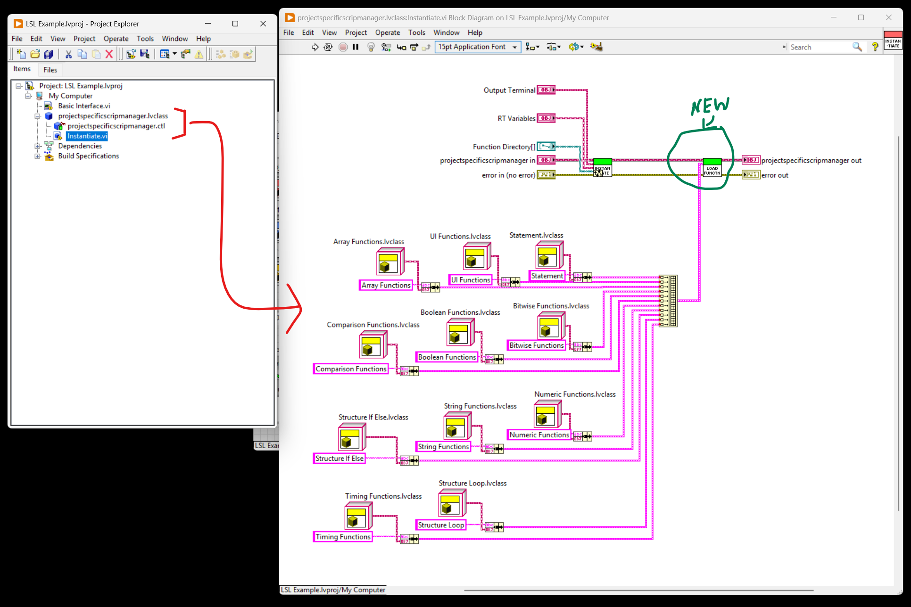
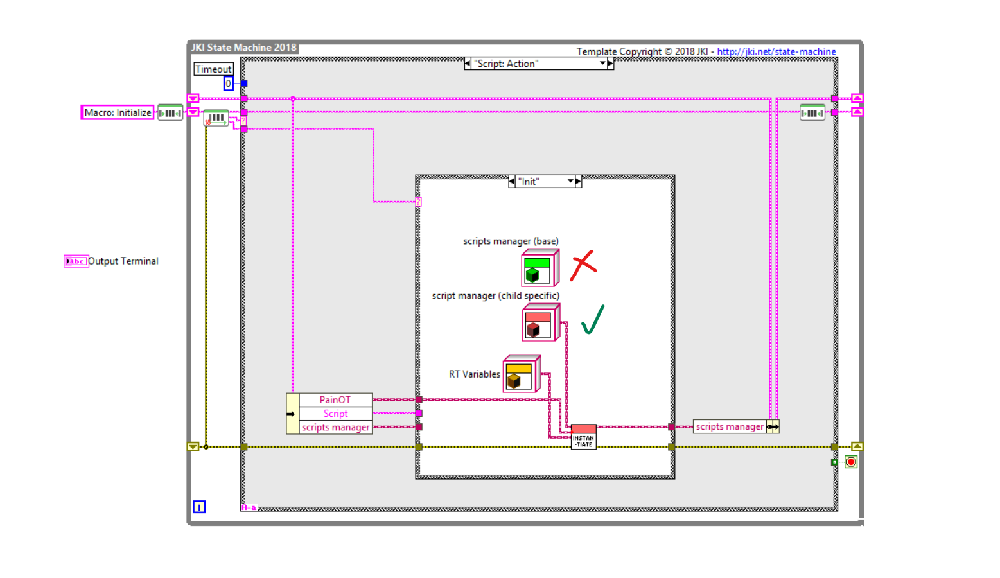
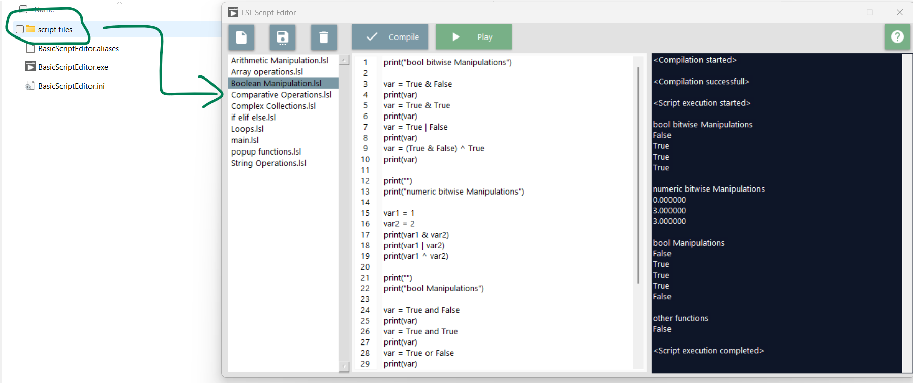

# LabVIEW Script Interpreter build issue

__NOTE: BELOW WORKS ONLY IN THE COMMIT MADE ON APRIL 3, 2026__

## Executable Build Process Issues:
- The LSL libraries dynamically loads the `basic` and `custom` functions from folder locations into the framework. The downside to this is, when built as a executable, the EXE also looks for the `basic` and `custom` functions in the similar configured folder. If it doesn't find them, it will throw an error.
- These `function child classes` cannot be simply copied into a folder alongside the EXE; they need to be included in the build specification to be `source distributed` so that the executable can load them along with its dependencies.
- Distributing all these plugins as executable is a time consuming work and not everyone like it (including me).

## Solution:
- One way to workaround this is to, load the `child function classes` as static factory pattern, instead of `dynamic factory pattern` so that the executable has all the function classes compiled in and does not need to load them dynamically from folders.
- This can be achieved by `creating a inherited child class for script manager`, that is specific to you project.
- Just `override the Instantiate method` in your inherited script manager class, and instead of dynamically loading the function classes from folders, `you can statically instantiate all the function classes` so that they are compiled into the executable and available at runtime without needing to load them from external folders.

Inherited Child Script Manager Class:

How it is Instantiated:

## Test Case
- I have used the `LSL Example.lvproj` --> `Basic Interface.vi` to test this approach.
- Created a build specification in the project for `Executable` and included the inherited script manager class so that the function child classes are statically compiled into the executable.
- Built the executable and ran it to verify that it correctly loads the statically compiled function child classes without looking for them in external folders.
- `Test Scripts` are pasted parallel to the `EXE` in the `script files` folder so that the executable can find and run them at runtime.

## Conclusion
- Though dynamic loading gives the flexiblity to plugin the functions in runtime, without rebuilding the exe. The management of these plugin is complex, and building process is time consuming. (yet can be achived)
- Statically loading the plugins for a project is performant, as well as most project doesn't need the flexibility of dynamically loading function classes at runtime.